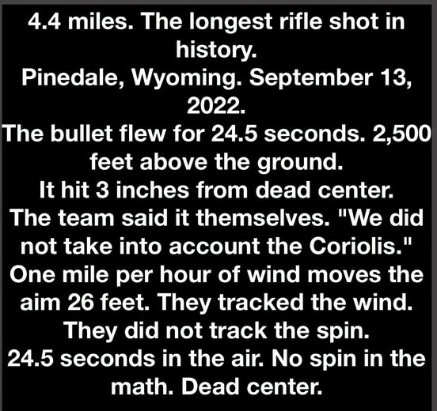

One of my Facebook friends, a flat-earth believer, posted [this netmeme](https://www.facebook.com/aero.plane.921/posts/pfbid0xamjRqqnmeMSTQFPDgmfw4XVj68yLDwy45ckTAXCXjPKCVfsNST18Lzyr8fkFUFRl) about the record-breaking 2022 7744-yard rifle shot in Wyoming, and I, foolishly, engaged the OP on the claim.

There are several writeups on the shot: <https://outdoorlife.com/guns/new-world-record-longest-rifle-shot>, <https://cowboystatedaily.com/2022/09/at-4-4-miles-wyoming-team-sets-new-rifle-shot-world-record>, and from the team itself, <https://nomadrifleman.com/world-record-shot/>, are some examples.

Hornady, the ammunition and reloading machinery manufacturer, in its [ballistics documentation](https://static.hornady.media/presscenter/docs/1410992918-4-DOF----Ballistic-Calculator-Technical-Document.pdf) says: "<cite>Many assume that the EBE is due to the earth rotating under the projectile. This is in fact not true.  For all practical purposes, in small caliber ballistics, the projectile remains attached to the reference frame of the earth. Simply put, the projectile starts out with the rotational velocity of the earth at the point it is fired and keeps that velocity component throughout its flight. What is actually happening is the projectile’s velocity is creating an increase or decrease in inertia, or a centrifugal force, which for a very brief time is trying to push the projectile either further away or closer to the earth.</cite>", "<cite>When firing at any north or south azimuths this adds a horizontal drift component to the projectile trajectory. Remember from above, the projectile has the same reference frame as the point on earth it was fired from. The projectile will have the rotational velocity vector at the point it was launched from.  The earth has the highest surface rotational velocity at the equator. Because it is a spherical surface, as you move away from the equator, north or south, the rotational speed at the surface is slower because of the smaller radius. In the northern hemisphere if you fire north the projectile will have a west to east velocity component greater than the impact point because you are firing to a smaller radius point on the earth. The projectile will drift slightly to the right.</cite>", and "<cite>To accurately predict the earth based effects on the projectile you must know relatively accurately what latitude you are firing from and what azimuth (compass angle) you are firing to. Earth based effects can essentially be ignored out to ranges of 1,000 yards as they are very small. We have done extensive testing at 1,500 yards and have found the earth based effects to be equal to or less than the normal variations of muzzle velocity, drag variation from bullet to bullet and tail or head wind effects.</cite>"

The OP, a certain pseudonymous Eric FETruther, has this misconception, judging by one of his replies, "... thank you for correcting me from 1,000 MPH to 760 MPH. You changed it from "target moves 4.6 miles" to "target moves 5.17 miles." You made my point STRONGER. Is 5 miles of movement better for you? Does 5 miles of target movement make your shot more believable?"

Then, in a later comment, he challenged me: "If the bullet and the target are both moving at 760 mph together, and the velocity is baked in, why would the bullet land left or right at all? What makes it drift sideways if everything is moving together? And how many feet, how many inches, how many MOA was that sideways drift on THIS shot?

"Not in theory. Not in a Hornady PDF. On THIS shot. With a number."

So, Eric, here's my answer.

Let's dig a little into the actual math involved, from <https://falconballistics.ca/utilities/coriolis-effect/>: <code>&Delta;y = &omega; &bullet; sin(&phi;) td</code>. Various websites and videos use either .000072921 or .000072722 as the &omega; value, the rotation speed of Earth in radians per second. That discrepancy is due to using a sidereal or a solar day, the former of which takes earth's revolution around the sun into account. The difference is minimal, so let's ignore it. <code>&phi;</code> is the latitude, <code>t</code> is time in seconds, and <code>d</code> is distance. Whatever unit you use for distance is the same for the delta-y, the resultant lateral drift will use the same.

The shot, according to the various sources, was 4.4 miles, or 7744 yards, at a NW trajectory, somewhere around Pinedale, Wyoming. I'm guessing probably in the Wind River range, Northwest of the town at around 43&deg; latitude. The team didn't provide GPS coordinates because it was on private land, according to an AI summary; I didn't find the source of that statement, but it was probably buried in the text of one of the above URLs, and anyway, it only matters when calculating drift up and down, which I won't go into here, at least not today. The travel time of the bullet was a little over 24.5 seconds.

Plugging those values into the above formula, we get <code>&omega; &bullet; sin(43.0) &bullet; 24.5 &bullet; 7744</code>, or <code>.0000729 &bullet; .682 &bullet; 24.5 &bullet; 7744</code>, yielding 9.43 yards. Remember to convert degrees latitude to radians if you're using Python as your calculator: <code>.0000729\*math.sin(math.radians(43))\*24.5\*7744</code>

So the calculated Coriolis drift is under 30 feet, compared to the stated 26 feet per 1 MPH increase in wind speed, which according to the sources varied between 6 and 9 MPH. That's why it was negligible compared to wind uncertainty.

The MOA calculation, according to Falcon, the POI (point of impact) is 4.18 MOA right of the POA (point of aim), so you'd need to dial the sights left by 4.18 (or 4.19 using the more accurate sidereal day), <code>0.25 &bullet; t &bullet; sin(&phi;)</code>, the same formula except dividing drift by distance to get minutes of arc.

So, while the west-to-east spin speed at 43&deg; north latitude was "baked into" (my words) the bullet at the moment it left the muzzle, the ground is <em>turning</em> under it as it flies, shifting the target to the left in the northern hemisphere, making the bullet fall to the right. It's that turning that creates the Coriolis drift.
